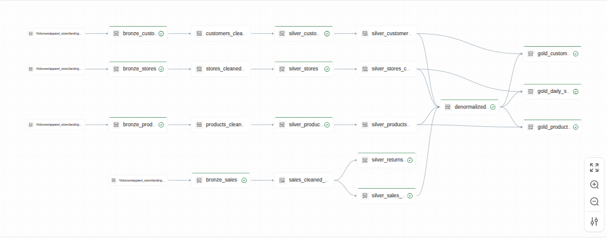

# Apparel Retail 360

## Context and Goal

**Context**: LoomLane Outfitters, a fictional 5-store apparel chain that runs its tills, loyalty program, product catalog and store records on separate systems. Store managers get yesterday's sales by email at noon, merchandising cannot see which items sell, and marketing ranks customers from a spreadsheet.

**Job**: one pipeline that turns the four raw feeds into three tables they can use on Monday morning: daily sales per store, product performance, and customer spend.

Using Lakeflow Spark Declarative Pipelines (formerly Delta Live Tables / DLT) to ingest raw data, progressively clean and transform it through a medallion architecture (Bronze, Silver, and Gold layers), and ultimately produce curated datasets ready for business intelligence and reporting.

## Architecture



## How to start

1. Create a Databricks Account

    - Sign up for a [Databricks Free Edition account](https://www.databricks.com/learn/free-edition) if you don't already have one.

2. Import this repository to Databricks

    - In the sidebar click **Workspace**, open your home folder, then click **Create** > **Git folder**.
    - Paste this repository's GitHub URL and click **Create Git folder** (a public repo needs no GitHub credentials).
    - The repo will appear as a folder in your workspace.
    - For more details, see [Databricks Git folders](https://docs.databricks.com/aws/en/repos/)

3. Open the `src/` folder and run `environment_setup.ipynb` to set up Unity Catalog (catalogs, schemas, volumes).
4. Read [ProjectPlan.md](docs/ProjectPlan.md) for the full step-by-step guide.

## Project Structure

```
.
├── .gitignore
├── README.md                          # Project overview
├── docs/
│   ├── DataContract.md                # Every table pipeline must produce, with its columns, types and keys
│   ├── ProjectPlan.md                 # Step-by-step implementation
│   ├── SyntheticDataGenerator.md      # Details about the data generator and schemas
├── src/
│   ├── 01_bronze.py                   # Bronze layer: Raw data ingestion from the landing folders
│   ├── 02A_silver.py                  # Silver layer: cleaned views with data quality expectations for all four streams
│   ├── 02B_silver.py                  # Silver layer: SCD Type 2 dimensions for customers, products and stores
│   ├── 02C_silver.py                  # Silver layer: sales and returns fact tables
│   ├── 02D_silver.py                  # Silver layer: current-version views of the three dimensions
│   ├── 03_gold.py                     # Gold layer: Business-ready aggregations and analytics
│   ├── data_generator.py              # Synthetic data generator that creates realistic streaming data
│   ├── environment_maintenance.ipynb  # Notebook provides maintenance utilities for the environment
│   ├── environment_setup.ipynb        # Notebook to set up Unity Catalog (catalogs, schemas, volumes)
│   ├── variables.py                   # Configuration file for catalog names, paths, and other settings
```

## Learning Objectives

- Ingesting and processing continuous data streams.
- Applying and managing data quality expectations.
- Implementing a medallion architecture in Lakeflow pipeline.
- Handling historical data changes using Slowly Changing Dimensions (SCD Type 2).
- Creating business-ready, aggregated tables for analytics.